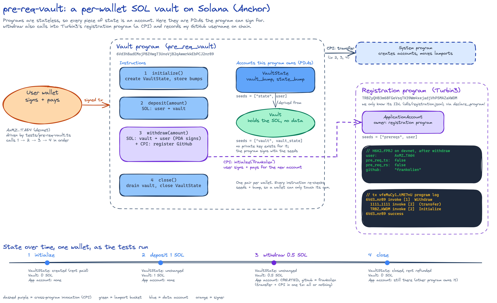

# pre-req-vault

Turbin3 Builders Cohort prerequisite, Part 1. An Anchor vault program that lets each
wallet park SOL in its own program-derived vault, extended so that `withdraw` performs a
Cross-Program Invocation (CPI) into the Turbin3 registration program and records my GitHub
username on chain.

| | |
|---|---|
| Vault program (mine, devnet) | `6Vd3hBadEMojPBZHwgT3UnoVjB2qAwwrkkEbPCJ2nr89` |
| Registration program (Turbin3, devnet) | `TRBZyQHB3m68FGeVsqTK39Wm4xejadjVhP5MAZaKWDM` |
| Wallet used | `AxMZj6QHB4Zxe7wpUCidh1cS7ueN2MGsiWLKCMokTA64` |
| ApplicationAccount PDA created by the CPI | `H6K2GuKuYKhDvqEmk2jq96tErtvRzkPpbECxvgY6fPRJ` |
| Withdraw tx (contains the CPI) | [`vfeMuCy1…tME7nU`](https://explorer.solana.com/tx/vfeMuCy1hdjnhWcTu7TQbNNkyvUiDAQzbYzDQHmsH2j6jeUsL9m2ms3Knw7WZKAmcq1dQpQNc2QqKGPhGtME7nU?cluster=devnet) |
| GitHub recorded | `frankolien` |

## Architecture



Source: [docs/architecture.excalidraw](docs/architecture.excalidraw) (open it at excalidraw.com to edit).

### Instructions

| Instruction | What it does | Signer |
|---|---|---|
| `initialize` | Creates the `VaultState` PDA (`["state", user]`) and stores the bumps of both PDAs. | user |
| `deposit(amount)` | System transfer user → `Vault` PDA (`["vault", vault_state]`). | user |
| `withdraw(amount)` | System transfer `Vault` → user, signed by the program with the vault seeds. Then CPI `registration::initialize(github)`, which creates the `ApplicationAccount` PDA (`["prereqs", user]`, owned by the registration program) and writes the GitHub username. | user; program signs for the vault PDA |
| `close` | Drains the vault back to the user and closes `VaultState`, refunding its rent. | user; program signs for the vault PDA |

### Accounts

- `VaultState` (owned by this program): `vault_bump: u8`, `state_bump: u8`. One per user.
- `Vault` (System account, no data): holds the lamports. No private key exists for it; the program signs with seeds.
- `ApplicationAccount` (owned by the registration program): `user`, `bump`, `pre_req_ts`, `pre_req_rs`, `github`.

## The CPI (what changed)

[programs/pre-req-vault/src/instructions/withdraw.rs](programs/pre-req-vault/src/instructions/withdraw.rs)

The registration program's interface is pulled in from `idls/registration.json` by
`declare_program!(registration)`, which generates the `cpi::accounts::Initialize` struct and the
`cpi::initialize` helper. After the SOL transfer, `withdraw` builds the CPI context and calls it:

```rust
let cpi_accounts = Initialize {
    user: self.user.to_account_info(),
    account: self.application_account.to_account_info(),
    system_program: self.system_program.to_account_info(),
};
let cpi_ctx = CpiContext::new(self.application_program.key(), cpi_accounts);
initialize(cpi_ctx, GITHUB_USERNAME.to_string())?;
```

Notes:

- The user already signed the outer transaction, so their signer privilege is forwarded through the CPI. No PDA signer seeds are needed for this call.
- `application_account` is declared as `UncheckedAccount` with `seeds::program = application_program`, so Anchor verifies the client passed the correct PDA even though our program never deserialises it.
- `application_program` is typed as `Program<'info, registration::program::Q3PreReqsRs>`, so the call can only ever target the real registration program ID.
- The SOL transfer and the registration happen in one transaction. If the registration fails (for example, the wallet is already registered), the withdrawal is rolled back too.
- `GITHUB_USERNAME` lives in [constants.rs](programs/pre-req-vault/src/constants.rs).

Devnet log of the withdraw transaction, showing the nested invocation:

```
Program 6Vd3hBadEMojPBZHwgT3UnoVjB2qAwwrkkEbPCJ2nr89 invoke [1]
Program log: Instruction: Withdraw
Program 11111111111111111111111111111111 invoke [2]
Program 11111111111111111111111111111111 success
Program TRBZyQHB3m68FGeVsqTK39Wm4xejadjVhP5MAZaKWDM invoke [2]
Program log: Instruction: Initialize
Program 11111111111111111111111111111111 invoke [3]
Program 11111111111111111111111111111111 success
Program TRBZyQHB3m68FGeVsqTK39Wm4xejadjVhP5MAZaKWDM success
Program 6Vd3hBadEMojPBZHwgT3UnoVjB2qAwwrkkEbPCJ2nr89 success
```

## Running it

Prerequisites: Rust, Solana CLI 3.x, Anchor CLI, pnpm, a funded devnet wallet at `~/.config/solana/id.json`.

```bash
pnpm install
anchor build          # also regenerates target/idl and target/types
anchor test           # deploys to devnet (cluster set in Anchor.toml) and runs tests/pre-req-vault.ts
```

To deploy under your own program ID, run `anchor keys sync` after the first build so that
`declare_id!` and `Anchor.toml` match the keypair in `target/deploy/`, and set `GITHUB_USERNAME`
to your own handle. Each wallet can register only once; a second `withdraw` from the same wallet
fails inside the registration CPI.

Things I hit on the way:

- `anchor test` deploy failed with `invalid program argument` after adding the CPI, because the
  new binary was larger than the program data account from the first deploy. Fixed with
  `solana program extend <PROGRAM_ID> 40000`.
- pnpm refused to install until `pnpm-workspace.yaml` had real values for `allowBuilds`.

Test run against devnet:

```
  pre-req-vault
    ✔ Initialize the vault
    ✔  Deposilt 1 Sol in to the vault
    ✔  Withdraw 0.5 Sol from the vault
    ✔  Close the vault and withdraw all the funds

  4 passing
```
